# Research: Spotify Downloader dengan Output WAV Asli (True PCM) — Mobile + Desktop

> Status: **Research / draft arsitektur** — belum ada keputusan final, belum ada kode.
> Bahasa: Indonesia dengan istilah teknis English.

---

## 1. Ringkasan Eksekutif

User ingin membangun Spotify downloader yang bisa menghasilkan **file WAV asli** — bukan MP3 yang cuma diganti extension/container-nya jadi `.wav`, tapi file WAV yang isinya **raw PCM** (uncompressed), hasil decode sungguhan dari audio Spotify.

Target akhir: **desktop app + mobile app** dari satu basis kode yang sama (sebisa mungkin shared core).

Temuan utama research:

| Poin | Kesimpulan |
|---|---|
| **Sumber audio** | WAV asli dari Spotify bisa didapat **tanpa Premium** via *librespot-python* (yang dipakai zotify) — dibatasi kualitas **160 kbps Ogg Vorbis** (Premium = 320 kbps). Jalur yt-dlp/YouTube (Sunnify sekarang) tetap opsi fallback. **Catatan penting:** librespot versi Rust resmi menolak free account; yang terbukti jalan untuk free adalah librespot-python. Ini ngaruh ke pilihan stack (lihat Section 11). |
| **Kualitas maksimal** | Stream Spotify = **Ogg Vorbis 320 kbps, 44.1 kHz, stereo**. Setelah di-decode jadi PCM, itu batas kualitas maksimal yang bisa didapat dari Connect backend. **Lossless/FLAC belum tersedia** untuk librespot (Spotify HiFi belum keluar ke endpoint Connect publik). |
| **"Real WAV" yang dimaksud** | WAV yang data chunk-nya berisi **raw PCM s16le**, dengan header RIFF yang benar. Bukan MP3 frame yang ditaruh di dalam container WAV. Verifikasi: `ffprobe` harus nunjukin `codec_name=pcm_s16le`. |
| **Stack rekomendasi** | **Rust shared core (librespot sebagai library crate)** + **Tauri 2** (desktop, iOS, Android) — satu bahasa, satu core, tanpa sidecar. Alternatif: Flutter + `flutter_rust_bridge`. |
| **Posisi Sunnify sekarang** | Python + PyQt6 + yt-dlp, sumber audio YouTube, output WAV via transcode FFmpeg. WAV-nya "asli PCM" secara teknis, tapi sumber audionya YouTube (bukan Spotify), jadi kualitas terbatas. |

---

## 2. Masalah: Kenapa Banyak "Spotify → WAV" Itu Palsu

Ada beberapa cara "membuat WAV dari Spotify" yang lazim dijumpai, dan kebanyakan bukan WAV sungguhan:

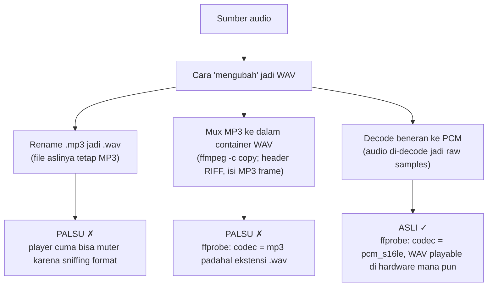

**Cara verifikasi WAV asli (harus diterapkan sebagai test di project ini):**

```bash
ffprobe -v error -show_streams -show_format output.wav
# Harus muncul:
#   codec_name=pcm_s16le  (atau pcm_f32le)
#   sample_rate=44100
#   channels=2
#   format_name=wav
#   bit_rate ≈ 1411200 (44100 × 2 × 16 bit)
```

Kalau muncul `codec_name=mp3` / `aac` / `vorbis` dengan ekstensi `.wav` → itu WAV palsu.

---

## 3. Dua Jalur Arsitektur Sumber Audio

Ada dua filosofi yang sangat berbeda. Ini keputusan arsitektur paling fundamental.

```mermaid
flowchart TB
    subgraph JalurA["JALUR A — YouTube-based (Sunnify sekarang)"]
        A1["Spotify URL (playlist/album/track)"] --> A2["Scrape metadata<br/>dari halaman publik Spotify<br/>(spotifydown_api.py)"]
        A2 --> A3["Cari audio di YouTube<br/>via yt-dlp (judul + artist)"]
        A3 --> A4["Download audio YouTube<br/>(Opus/M4A, 128–256 kbps)"]
        A4 --> A5["Transcode ke WAV via FFmpeg<br/>(decode lossy → PCM)"]
    end
    subgraph JalurB["JALUR B — librespot-based (untuk WAV 'asli Spotify')"]
        B1["Login akun Spotify Premium<br/>(OAuth / Login5)"]
        B1 --> B2["Session ke Access Point Spotify<br/>(protokol Shannon-encrypted)"]
        B2 --> B3["Minta AudioKey (kunci AES)<br/>untuk file track tertentu"]
        B3 --> B4["Download audio ENCRYPTED<br/>dari CDN Spotify (Ogg Vorbis 320k)"]
        B4 --> B5["Decrypt AES + decode Vorbis<br/>→ raw PCM (f32)"]
        B5 --> B6["Tulis PCM + header RIFF<br/>→ .wav asli (pcm_s16le)"]
    end

    style A5 fill:#ffd9d9
    style B6 fill:#d9ffd9
```

### Perbandingan

| Kriteria | Jalur A (YouTube) | Jalur B (librespot) |
|---|---|---|
| Sumber audio | YouTube (beda track bisa beda kualitas) | **Stream Spotify itu sendiri** |
| Butuh Premium? | Tidak | **Tidak wajib**: free = 160 kbps (via librespot-python), Premium = 320 kbps |
| "Real WAV" | PCM asli tapi sumber lossy YouTube | PCM asli dari stream Spotify 320 kbps |
| Kualitas audio | Tergantung video yang ketemu (sering 128–256 kbps) | Konsisten 320 kbps Vorbis |
| Risiko akun | Rendah | Sedang (protokol reverse-engineered, melanggar ToS; bisa kena ban) |
| Kompleksitas | Rendah (yt-dlp sudah matang) | Tinggi (protocol stack, DRM decrypt, perawatan saat Spotify update) |
| Kecepatan download | ~realtime atau sedikit lebih cepat | **Jauh lebih cepat dari realtime** (decode >100x) |
| Legal | Grey area (konten YouTube) | Melanggar ToS Spotify |

> **Rekomendasi:** Kalau tujuannya "WAV sungguhan dari Spotify", **Jalur B wajib**. Jalur A bisa dipertahankan sebagai fallback (tanpa Premium) dengan catatan kualitas WAV-nya bukan dari Spotify.

---

## 4. Cara Kerja Sistem: Protokol Spotify via librespot

librespot = open-source Rust implementation dari protokol client Spotify (pengganti libspotify yang deprecated). Ini bukan library resmi — di-reverse engineer dari behavior client asli.

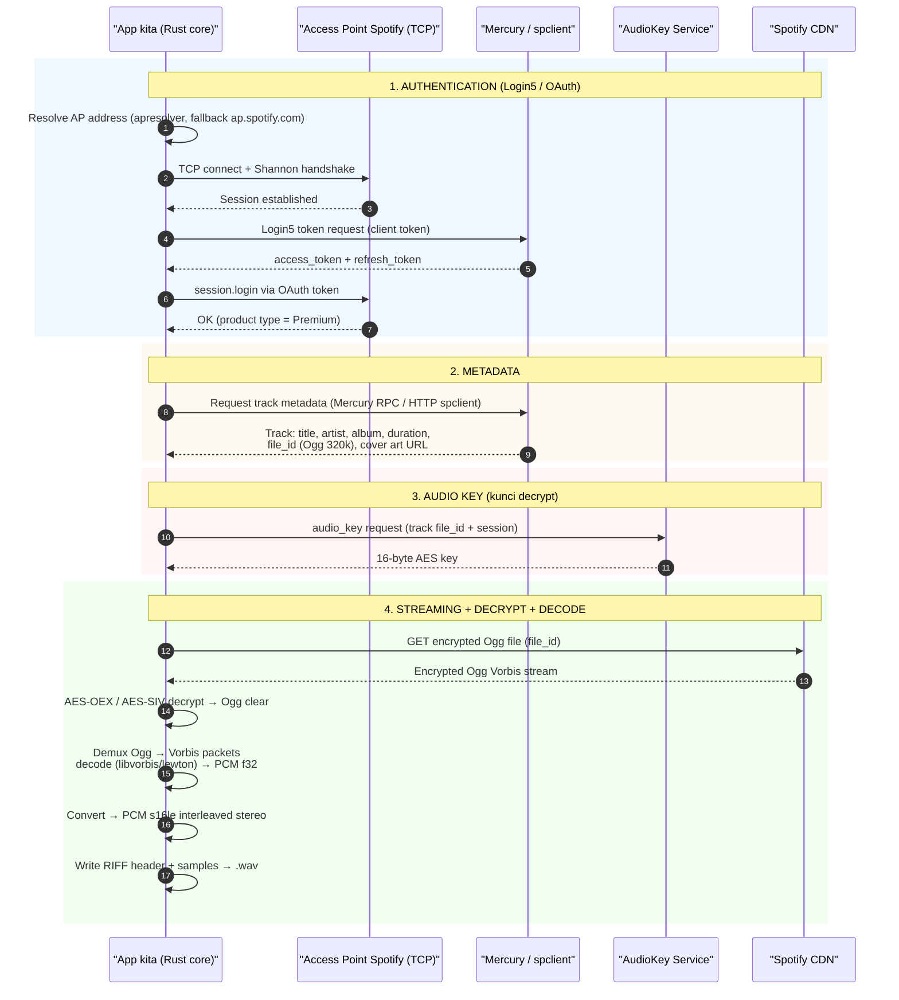

Detail penting:

- **Auth (2024+):** username/password langsung tidak bisa lagi — Spotify mewajibkan **verifikasi via browser** (OAuth flow, Login5). Flow: app membuka URL login → user login di browser → token dikembalikan ke app → disimpan sebagai credential blob.
- **Session & enkripsi:** koneksi ke AP dienkripsi protokol Shannon. Di atasnya ada beberapa kanal logis: **Mercury** (RPC metadata), **Channel** (audio streaming), **AudioKey** (kunci decrypt per file), **Dealer** (WebSocket untuk control Connect — tidak penting untuk downloader).
- **v0.5.0+ librespot:** sebagian besar protokol pindah dari Mercury ke **HTTP via spclient** (ini yang dipakai downloader modern — lebih stabil).
- **Format stream:** Ogg Vorbis 96/160/320 kbps (Premium). Sebagian track/podcast pakai AAC. Bitrate dipilih saat request; untuk WAV selalu minta **320 kbps**.
- **Sample rate stream = 44.1 kHz, stereo** → decode langsung jadi PCM 44.1k stereo, **tidak perlu resample** (ideal untuk WAV CD-standard).
- **Music tidak bisa di-stream oleh free account pada kualitas 320; librespot secara umum memerlukan Premium.**

---

## 5. Pipeline Audio → WAV (Inti dari project ini)

Ini bagian yang paling penting dan harus paling teliti. Urutannya: **decrypt → decode → PCM → WAV mux** — tidak ada encode ulang lossy sama sekali.

```mermaid
flowchart LR
    subgraph Download["DOWNLOAD & DECRYPT"]
        D1["Encrypted Ogg Vorbis<br/>dari CDN (320 kbps)"] --> D2["AES-OEX / AES-SIV<br/>decrypt (kunci dari AudioKey)"]
        D2 --> D3["Ogg Vorbis clear"]
    end
    subgraph Decode["DECODE"]
        D3 --> D4["Demux Ogg pages"]
        D4 --> D5["Vorbis decode<br/>(libvorbis / lewton)"]
        D5 --> D6["PCM f32 floating<br/>interleaved stereo"]
    end
    subgraph Wav["WAV MUX"]
        D6 --> D7["Convert f32 → s16<br/>(16-bit integer PCM)"]
        D7 --> D8["Tulis header RIFF<br/>(fmt chunk: tag 1, 44.1k, 2ch, 16bit)"]
        D8 --> D9["Tulis data chunk<br/>(raw samples)"]
        D9 --> D10["+ metadata:<br/>ID3v2 chunk / LIST-INFO<br/>(title, artist, album, cover art)"]
        D10 --> D11["✅ output.wav<br/>pcm_s16le asli"]
    end

    style D11 fill:#d9ffd9,stroke:#2e7d32
```

### Parameter teknis WAV (harus eksplisit di spesifikasi)

| Parameter | Nilai | Catatan |
|---|---|---|
| Format audio | **PCM s16le** (format tag 0x0001) | WAV CD-standard; paling kompatibel |
| Sample rate | **44100 Hz** | Sama dengan stream Spotify → tanpa resample |
| Channels | **2 (stereo interleaved)** | |
| Bit depth | **16-bit** | Opsi pro: 24-bit (upscale dari 16 — tidak menambah kualitas, hanya ruang disk) |
| Byte rate | 44100 × 2 × 2 = **176,400 B/s** | ~10.09 MiB/menit |

### Ukuran file (antisipasi storage, penting untuk mobile)

```
1 menit  ≈ 10.1 MB
3.5 menit (track biasa) ≈ 37 MB
1 album (40 menit)      ≈ 420 MB
1 playlist 100 track     ≈ 1.2–1.5 GB
```

> Ini trade-off besar WAV di mobile: 10 MB/menit. Pertimbangkan opsi "FLAC" atau "WAV" bersama di UI, atau peringatan ukuran sebelum batch download di perangkat mobile.

### Metadata WAV

WAV tidak punya ID3 secara native, tapi ada dua mekanisme yang didukung player modern:

1. **LIST/INFO chunk** — standar RIFF untuk title, artist, album, year, genre, track number. Dibaca oleh Windows Explorer, macOS, VLC, dll.
2. **ID3v2 chunk (id3 chunk)** — bisa disisipkan ke WAV; dibaca oleh banyak player (termasuk cover art APIC).

Rekomendasi: tulis **keduanya** (INFO untuk kompatibilitas + ID3v2 untuk cover art). Pakai `mutagen` (Python) atau `lofty`/`symphonia` (Rust).

---

## 6. Arsitektur Target: Mobile + Desktop dari Satu Core

Target user: **satu codebase audio engine untuk semua platform**. Ada 2 opsi utama — keduanya sama-sama menaruh logika berat di **Rust core** yang berisi librespot.

### Opsi 1 (Rekomendasi): Rust core + Tauri 2

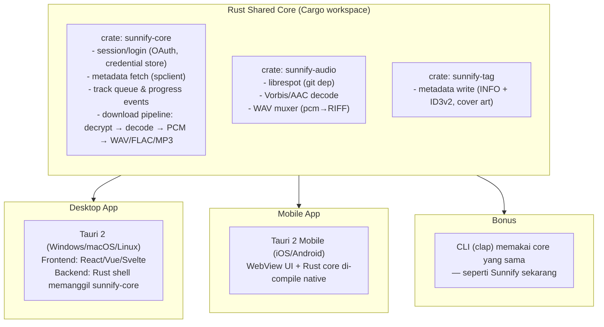

Keuntungan:

- **Satu bahasa (Rust)** dari protocol stack sampai UI backend → tidak ada bridging, tidak ada sidecar binary.
- Tauri 2 resmi support **desktop + iOS + Android** dari satu codebase (mobile support ditambahkan 2024).
- Binary kecil, memory ringan dibanding Electron.
- librespot bisa jadi **dependency crate langsung** (bukan process terpisah) → download pipeline di dalam satu process.
  - **CAVEAT (update penting):** ini hanya jalan untuk akun **Premium**. librespot-rs resmi menolak free account (lihat Section 11 — free account wajib pakai jalur librespot-python, yang berubah jadi sidecar/process terpisah).

### Opsi 2: Flutter UI + Rust core (flutter_rust_bridge)

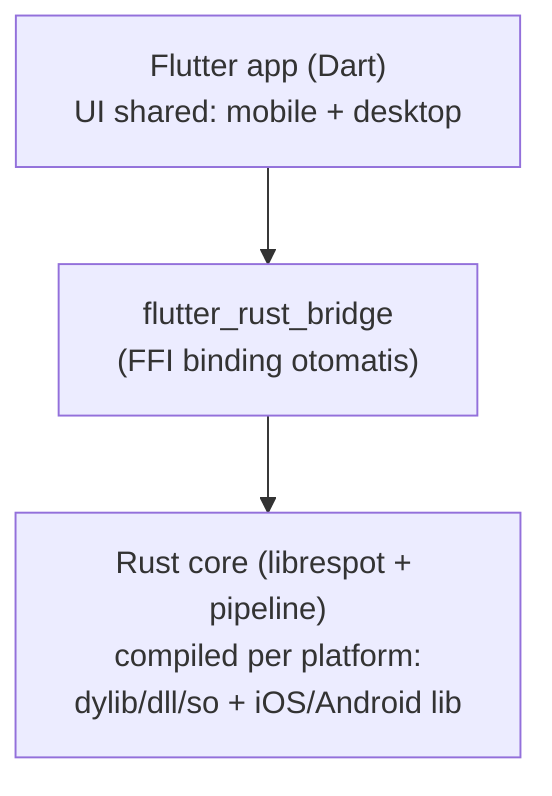

Keuntungan: Flutter UI paling matang untuk mobile-first, widget seragam mobile+desktop. Referensi nyata: **Spotube** (48k+ stars) — Spotify client Flutter + librespot-java via JNI yang jalan di mobile & desktop.

### Opsi 3: Pertahankan Python (librespot-python) + shell baru

Cepat untuk prototipe (langsung `pip install librespot`), tapi jelek untuk mobile (perlu Chaquopy/embedded Python di Android, sangat sulit di iOS) dan desktop packaging berat. **Hanya untuk prototipe / bukti konsep**, bukan produksi.

### Tabel keputusan stack

| Kriteria | Opsi 1: Tauri 2 + Rust core | Opsi 2: Flutter + rust bridge | Opsi 3: Python core |
|---|---|---|---|
| Kode UI shared mobile+desktop | Ya (webview + Rust) | Ya (Flutter) | Tidak |
| Core shared | Rust (sama dengan librespot) | Rust | Python (port) |
| Performa pipeline | Native terbaik | Native (FFI) | Lambat-ish, decode via eksternal |
| Mobile iOS | Ya (WKWebView + Rust) | Ya | Sangat sulit |
| Android | Ya (WebView + Rust) | Ya | Sulit (Chaquopy) |
| Packaging size | Kecil | Sedang | Besar |
| Contoh sukses | — (pola baru) | Spotube | zotify (CLI only) |
| Effort | Sedang | Sedang-tinggi | Rendah (prototipe) |

---

## 7. Modul & Komponen yang Harus Dibangun

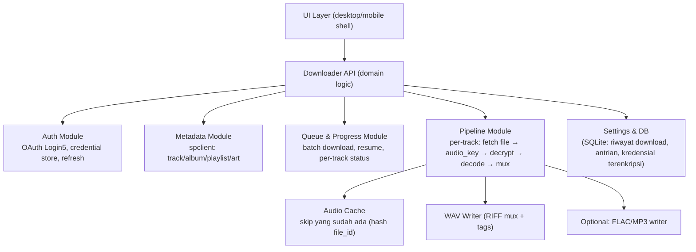

Fitur wajib yang harus ada di core (agar worth it):

1. **Auth dengan browser flow** + persist credential (terenkripsi di keychain/keystore).
2. **Batch download playlist/album** dengan queue + progress event (persentase per track, ETA).
3. **Resume & skip**: file yang sudah ada (cek via file_id hash) tidak didownload ulang.
4. **Verifikasi output**: setelah nulis, jalankan check header (bukan ffprobe eksternal — cukup baca RIFF header di memory) → jamin `pcm_s16le`.
5. **Concurrency terkendali**: 1 session librespot bisa download banyak track paralel; mulai dari 2–4 paralel, throttle CPU.
6. **Pilihan format**: WAV (default sesuai request), FLAC (hemat 50%+ ruang, tetap lossless), MP3 (untuk mobile).

---

## 8. Risiko & Catatan Penting

| Risiko | Penjelasan | Mitigasi |
|---|---|---|
| **ToS / ban akun** | Protokol librespot di-reverse-engineer; melanggar ToS Spotify. Sering download 320kbps bisa mencurigakan. | Sertakan disclaimer kuat (Sunnify sudah punya `DISCLAIMER.md`). Jangan nama produk sebagai tool piracy. |
| **Perubahan protokol** | Spotify bisa ubah auth/protocol kapan saja → tool berhenti bekerja (seperti yang terjadi ke zotify Agustus 2025). | Pin versi librespot, update terjadwal, arsitektur modul auth terisolasi. |
| **Lossless tidak tersedia** | WAV dari Spotify tetap "lossy source" (Vorbis 320). WAV ≠ kualitas CD. | Jangan claim "lossless". Labeli jujur: "uncompressed WAV dari stream 320kbps". |
| **Ukuran file besar** | 10 MB/menit — masalah di mobile. | Peringatan UI, opsi FLAC, batas storage check. |
| **Store policy** | App yang download DRM music biasanya ditolak dari App Store / Play Store. | Target distribusi sideload/desktop; mobile build via sideload (Android APK / TestFlight). |
| **Parallel download di mobile** | Baterai & thermal. | Batasi concurrency, pause saat background. |

---

## 9. Rekomendasi Roadmap

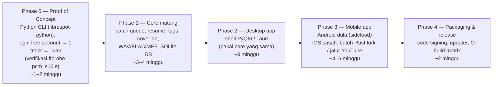

> **Kenapa Phase 0 pindah ke Python?** Karena free-account (kebutuhan utama user) cuma terbukti jalan di librespot-python, bukan librespot-rs. Prototipe Python = jalur termurah untuk verifikasi teknis ini sebelum komit ke arsitektur jangka panjang.

### Yang bisa dikerjakan SEKARANG (tanpa nunggu keputusan final)

1. Prototipe CLI Python kecil: `pip install librespot` (librespot-python), login OAuth browser flow, download 1 track dengan free account, output WAV, verifikasi header (ffprobe).
2. **Uji kritis yang menentukan segalanya:** cek apakah track yang mau didownload free-account beneran bisa di-stream 160kbps, berapa persen yang error "premium required", dan apakah ada session termination/rate limit. Hasil uji ini nentuin pilihan arsitektur final.
3. Siapkan repo test: golden file WAV (synthesize PCM → tulis RIFF → bandingkan byte).
4. Riset lanjutan: baca `SPEC.md` alice-spotify-bridge (referensi pipeline librespot → PCM → encoder) dan DeepWiki zotify (pipeline download + tag, termasuk handling free account).

---

## 10. Referensi

- librespot (Rust): https://github.com/librespot-org/librespot — protocol stack, audio decrypt (`librespot-audio`), decoder Symphonia
- librespot-java: https://github.com/librespot-org/librespot-java — basis Spotube
- librespot-python: https://github.com/kokarare1212/librespot-python — untuk prototipe cepat
- zotify: https://github.com/zotify-dev/zotify — referensi downloader Python production (audio processing: https://deepwiki.com/zotify-dev/zotify/7-audio-processing)
- **zotify fork aktif (free account):** https://github.com/DraftKinner/zotify dan https://codeberg.org/pitu/zotify — bukti free account bisa download 160 kbps via librespot-python; dokumentasi error "session has been terminated"
- oggify: https://github.com/uways/oggify — contoh downloader librespot→Ogg terkecil
- alice-spotify-bridge SPEC: https://github.com/volodarskij/alice-spotify-bridge/blob/master/bridge/SPEC.md — contoh konkret librespot → PCM → encoder (pola yang sama persis dengan pipeline WAV kita)
- Tauri 2: https://tauri.app — desktop + iOS + Android
- Spotube: https://github.com/KRTirtho/spotube — bukti nyata Flutter + librespot-java di mobile & desktop
- Batasan lossless librespot: https://github.com/librespot-org/librespot/issues/1583
- Verifikasi WAV: `ffprobe -v error -show_streams file.wav` → `codec_name=pcm_s16le`
- **spotDL (matching engine / jalur tanpa akun):** https://github.com/spotDL/spotify-downloader — arsitektur provider plugin (`spotdl/providers/audio/`), limitasi kualitas YouTube (128/256k) dokumentasi resmi di ReadTheDocs
- **SpotiFLAC (prototipe "Spotify → FLAC lossless" tanpa akun):** https://github.com/spotbye/SpotiFLAC — matching ke Tidal/Qobuz/Amazon via unofficial API; **contoh bagusnya arsitektur, contoh buruknya stabilitas sumber**
- **Streamrip / Deemix-DL (Deezer lossless):** https://github.com/honeubadger/deemix-api — FLAC butuh Deezer HiFi; ARL token expire 90–120 hari sejak 2024

---

## 11. Deep-Dive: Mendapatkan WAV TANPA Premium (Kebutuhan Utama User)

> Update berdasarkan keputusan user: **WAV asli tanpa akun Premium**, output WAV + FLAC + MP3, level arsitektur.

### 11.1 Fakta kualitas stream per tier (verifikasi 2025–2026)

| Tier | Kualitas stream | Format |
|---|---|---|
| **Free** | 96 kbps (normal) / **160 kbps (high — maksimal untuk free)** | Ogg Vorbis |
| **Premium** | 96 / 160 / 320 kbps | Ogg Vorbis |
| **HiFi** (rollout terbatas, mulai Sept 2025) | FLAC lossless 16-bit/44.1 kHz – 24-bit/192 kHz | FLAC — **TAPI hanya via app resmi; tidak tersedia untuk client eksternal/librespot** |

Jadi jawaban jujurnya: **"WAV tanpa Premium" itu POSSIBLE — dengan kualitas sumber maksimal 160 kbps Ogg Vorbis**, lalu di-decode jadi PCM. WAV-nya tetap WAV asli (pcm_s16le), tapi source-nya lossy 160kbps. Ini batas teknis yang tidak bisa ditembus — kualitas 320 kbps ditentukan server berdasarkan tier akun, bukan oleh client.

### 11.2 Jalur yang terbukti bekerja: librespot-python (jalur zotify)

Temuan kunci dari research:

- **zotify** (dan fork aktifnya, DraftKinner/zotify, pitu/zotify) membuktikan **free account bisa download langsung dari stream Spotify** tanpa Premium. README fork: *"Save tracks at up to 320kbps (1) — (1): Non-premium accounts are limited to 160kbps"*. Audio 100% dari Spotify, bukan substitusi YouTube.
- Yang dipakai zotify adalah **librespot-python** (port Python dari librespot), bukan librespot-rs.
- **librespot-rs (Rust) eksplisit menolak free account**: README resmi — *"librespot only works with Spotify Premium. This will remain the case. We will not support any features to make librespot compatible with free accounts"*.

> **Implikasi arsitektur yang mengubah segalanya:** kebutuhan free account membuat **Python core lebih layak secara teknis** daripada Rust core, setidaknya untuk sekarang. Ini membalik rekomendasi stack di Section 6.

### 11.3 Arsitektur pipeline WAV tanpa premium

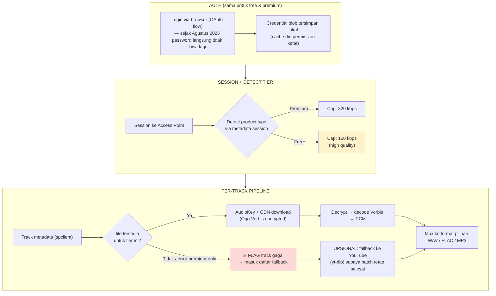

### 11.4 Komponen yang harus ada khusus untuk free account

| Komponen | Fungsi | Catatan |
|---|---|---|
| **Tier detector** | Baca product type dari session → set bitrate cap | Free = 160, Premium = 320; jangan pernah minta 320 di free (server tolak) |
| **Error classifier** | Bedakan error "premium-only track", "session terminated", rate limit, network | Masing-masing punya handling berbeda (skip+report / relogin / backoff / retry) |
| **Fallback engine** | Track yang gagal → cari di YouTube via yt-dlp (metadata dari Spotify yang sama) | Opsional tapi sangat direkomendasikan supaya batch 100% selesai |
| **Relogin flow** | Deteksi "session has been terminated" → trigger ulang browser OAuth | Error khas free account (didokumentasikan zotify) |
| **Throttle mode** | Opsi download "real-time" (kecepatan = durasi track) | zotify punya ini sebagai mode anti-deteksi; default: fast, opsional: real-time |
| **Concurrency rendah** | Free account lebih sensitif; mulai 1–2 paralel | Naikkan bertahap kalau stabil |

### 11.5 Perbandingan 4 opsi untuk "WAV tanpa premium"

| Opsi | Sumber audio | Free? | Kualitas WAV | Risiko | Keputusan |
|---|---|---|---|---|---|
| **A. librespot-python free account** | Stream Spotify (160k Vorbis) | Ya | PCM asli dari Spotify, source 160k | Sedang (ToS), error per-track | ✅ Inti solusi |
| **B. Hook web player (teknik Soggfy)** | Intercept decoder di app resmi | Ya | PCM asli dari Spotify | **Tinggi**: inject memory, fragile tiap update, Windows-only, no mobile | ❌ Tolak |
| **C. YouTube (Sunnify sekarang)** | YouTube (128–256k Opus) | Ya | PCM asli, source YouTube | Rendah | ⚠️ Fallback |
| **D. Hybrid (A + C)** | Spotify dulu, YouTube untuk track yang gagal | Ya | Campuran | Sedang | ✅ **REKOMENDASI** |

### 11.6 Kenapa bukan jalur lain?

- **Preview 30 detik dari Web API resmi** — cuma 30 detik, MP3 kualitas rendah, bukan full track. Tidak relevan untuk download full lagu.
- **Deezer/JioSaavn/pihak ketiga** — bukan "dari Spotify"; quality dan legalitas lebih buruk. spotube pakai ini karena memang tidak mau Premium sama sekali, tapi user kita maunya source Spotify.
- **Bypass gating 320kbps** — tidak ada. Bitrate ditentukan server atas dasar tier akun; bukan hal yang bisa di-reverse-engineer atau di-bypass (dan tidak akan dibahas lebih lanjut).

---

## 12. Multi-Format Output: WAV + FLAC + MP3

Satu pipeline decode, banyak muxer — ini arsitektur yang harus dipegang supaya tidak duplikasi logika.

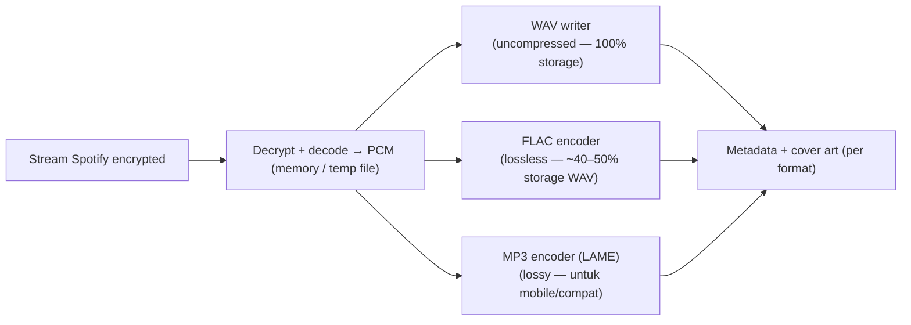

| Format | Kode | Ukuran (3.5 menit) | Catatan |
|---|---|---|---|
| **WAV** | pcm_s16le | ~37 MB | Default user; buat editing/DJ |
| **FLAC** | flac | ~20 MB | Lossless, hemat ruang — direkomendasikan untuk mobile |
| **MP3** | libmp3lame 256/320k | ~7–8 MB | Kompatibilitas player lama |

Implementasi per stack:
- **Python core** (jalur zotify): `soundfile` (WAV), `mutagen` + FFmpeg subprocess (FLAC/MP3 sudah dimiliki Sunnify sekarang).
- **Rust core** (masa depan): `hound`/`symphonia` (WAV), `flacenc`, `lame-rs`.

---

## 13. Rekomendasi Final & Keputusan yang Harus Diambil User

### Decision tree arsitektur (berdasarkan hasil riset ini)

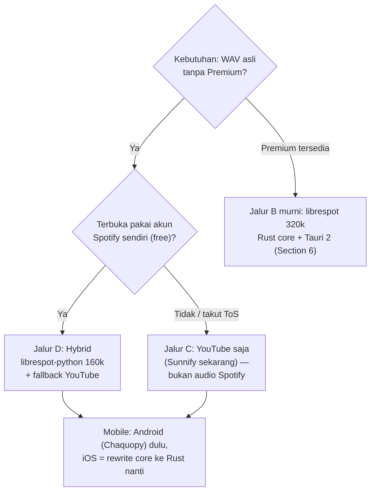

### Rekomendasi konkret

1. **Phase 0 wajib = prototipe Python** (`librespot-python`), bukan Rust — karena free account cuma terbukti di jalur ini. Verifikasi dulu: bisa login free, berapa % track yang ke-block, stabilitas session.
2. **Arsitektur final yang diusulkan**: Hybrid (Section 11.5 opsi D) — Spotify stream 160kbps sebagai primary, fallback YouTube untuk track yang gagal, jadi batch selalu selesai dan WAV yang dihasilkan mayoritas dari Spotify.
3. **Multi-format**: WAV default + FLAC + MP3 dari satu PCM (Section 12).
4. **Mobile**: realistisnya Android dulu (Python bisa dibundle via Chaquopy); iOS praktis butuh core Rust yang di-patch — keputusan yang ditunda sampai Phase 0 selesai dan datanya jelas.

### Keputusan yang gua butuhkan dari user

| # | Keputusan | Pilihan |
|---|---|---|
| 1 | Boleh pakai akun Spotify free milik sendiri untuk pengujian? | Ya / Tidak |
| 2 | Kalau ada track yang cuma bisa di-stream dengan Premium, diterima fallback ke YouTube? | Ya (hybrid) / Tidak (skip track) |
| 3 | Mode download default: cepat (anti-batch kecil) atau real-time (lebih aman)? | Cepat / Real-time / Keduanya (opsi) |
| 4 | Target mobile pertama: Android saja dulu atau sekalian dua-duanya? | Android dulu / Keduanya |

Setelah keputusan ini, gua bisa langsung mulai Phase 0 (prototipe Python CLI) atau kalau mau, gua lanjut riset ke level kode untuk pipeline WAV-nya.

---

## 14. Alternatif Utama: Tanpa Akun Spotify Sama Sekali — Auto-Match ke Sumber Lain

> Kebutuhan baru dari user: **"jangan pakai Spotify (akun) — tapi kalau aku tempel link playlist Spotify, app-nya otomatis cari audio (idealnya WAV) dari sumber lain."**

### 14.1 Jawaban singkat

**Ya, ini pola yang sudah terbukti dan justru lebih dekat ke Sunnify sekarang.** Konsepnya: link Spotify cuma dipakai untuk **baca metadata** (judul, artist, album — sudah dilakukan `spotifydown_api.py` tanpa login), lalu tiap track **di-match ke sumber audio lain**, di-download versi terbaik yang tersedia, dan di-mux jadi WAV/FLAC/MP3.

Ini arsitektur **spotDL** (25.8k stars, MIT, `spotdl` di PyPI) — tool paling banyak dipakai untuk "download playlist Spotify tanpa akun".

### 14.2 Cara kerjanya (level arsitektur)

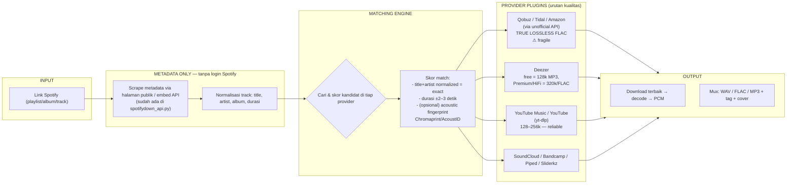

### 14.3 Realitas kualitas: "auto cari WAV" itu ada gradasinya

Ini yang wajib dikelola ekspektasinya. **Tidak ada** sumber gratis yang reliabel menyediakan file WAV/lossless untuk track Spotify sembarangan. Gradasi realistisnya:

| Provider | Kualitas maks | Account? | Reliabilitas | Legal/Risiko |
|---|---|---|---|---|
| **Qobuz / Tidal / Amazon** (via unofficial API, dipakai SpotiFLAC) | **TRUE lossless FLAC 16/44.1+** → WAV IDAMAN | Tidak | **Rendah** — API pihak ketiga sering mati/sunset, anti-bot | Tinggi (API tidak resmi) |
| **Deezer** | free = 128k MP3; Premium/HiFi = 320k / **FLAC 1411k** | Perlu akun Deezer (ARL token, expire 90–120 hari) | Sedang | Medium (deemix kena tekanan hukum, project lama mati) |
| **YouTube Music** | 128k (free) / 256k (premium) — **bukan lossless** | Tidak | **Tinggi** (yt-dlp sangat matang) | Rendah |
| **SoundCloud / Bandcamp** | Variatif, bisa FLAC untuk Bandcamp | Tidak | Rendah-sedang | Rendah |

> **Kesimpulan jujur:** "auto nyari WAV" yang stabil dan legal = artinya **PCM tulen dari audio terbaik yang ketemu**, yang mayoritas praktisnya YouTube (128–256k). Kualitas *lossless-to-WAV* baru tercapai lewat Qobuz/Tidal/Deezer-HiFi — dan itu semua sumber yang fragile, butuh akun, atau grey-area. **Arsitekturnya harus dibangun sebagai provider-plugin ladder** (coba kualitas terbaik dulu, turun ke terandalkan).

### 14.4 Kenapa arsitektur provider-plugin itu kunci

Pelajaran utama dari spotDL (video: `providers/audio/` = `base.py` + plugin per sumber) dan ekosistem Deemix/SpotiFLAC: **sumber audio hidup & mati terus-menerus** (API mati, akun dibekukan, kena tuntutan). Maka:

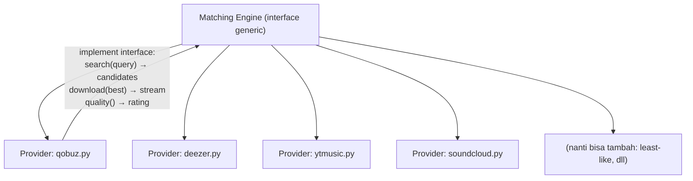

Setiap provider = satu modul yang implement interface seragam (`search + download + quality`). Matching engine:
1. Urutkan provider dari **kualitas terbaik → terandalkan**.
2. Cari kandidat di provider pertama; kalau skor match di atas threshold → pakai.
3. Kalau gagal/skor rendah → turun ke provider berikutnya.
4. Kalau semua gagal → track masuk daftar "failed" (report saja).

Dampak arsitektur: kalau satu sumber mati, user cukup update plugin/module (atau app-nya punya fallback otomatis), bukan redesign.

### 14.5 Skor match yang benar (biar tidak salah lagu)

spotDL pakai kombinasi ini — rekomendasi minimal:

| Signal | Bobot | Cara |
|---|---|---|
| Judul + artist (normalized) | Tinggi | Lowercase, hapus punctuation, hapus "(Official Video)" / "lyrics" suffix |
| Durasi track | Sedang | ±2–3 detik dari metadata Spotify |
| Nama album (jika tersedia) | Sedang | Kandidat yang punya album sama di-boost |
| Akustik fingerprint (opsional) | Tinggi | Chromaprint → cocokkan ke AcoustID — mahal tapi paling akurat |

### 14.6 Dua jalur yang sekarang bertentangan — mana yang dipilih?

Setelah research ini lengkap, keputusan user terpecah jadi dua jalur yang **berbeda fundamental**:

| | **Jalur MATCH (Section 14)** | **Jalur DIRECT (Section 11)** |
|---|---|---|
| Butuh akun Spotify? | **Tidak** — link saja | Ya (free/burner account) |
| Sumber audio | Sumber eksternal (YT, Qobuz, dst) | Stream Spotify itu sendiri (160/320k) |
| "WAV asli dari Spotify"? | Bukan — dari provider lain | Ya, dari Spotify |
| Kualitas praktis | 128–256k (YT) / lossless (Qobuz, fragile) | 160k (free) / 320k (premium) |
| Mirip Sunnify sekarang? | **Ya, 90%** | Tidak — perlu rewrite engine |
| Risiko akun | Tidak ada | Sedang (ToS / ban) |
| Kompleksitas | Sedang | Tinggi |
| **Kesesuaian kebutuhan user** | **Cocok** ("tanpa pakai Spotify") | Bergeser dari kebutuhan (tadi user bilang tanpa premium) |

> **Rekomendasi:** kalau prioritasnya **"tanpa akun Spotify"**, ambil **Jalur MATCH** — tinggal perbaiki/matang-kan pipeline Sunnify yang sudah ada (matching engine + provider plugin + PCM WAV/FLAC/MP3 mux), bukan mulai dari nol. Yang ditinggalkan: *kenyataan bahwa audio bukan dari Spotify* dan kualitas terbatas 128–256k kecuali sumber lossless (Qobuz/Tidal) mau diterima fragilitasnya.
